# Ask your tenant with Power Platform Admin in Cowork

Over the previous labs you built visibility the traditional way: inventory pages, KQL queries, an export flow, monitoring charts, and alert rules. Each one answers the questions it was built for — but leadership's questions keep changing. *What changed in the tenant last week? Which apps hasn't anyone used in a month? Who's affected if we block this connector?* Every new question means a new filter, a new query, or a new report.

**Power Platform Admin in Cowork** takes a different approach. You ask the question in plain language in [Microsoft Copilot Cowork](https://learn.microsoft.com/en-us/microsoft-365/copilot/cowork/), and the **Power Platform Admin** plugin gathers inventory, usage, and ownership data across your environments to answer it. Because the conversation happens in Cowork, you can then ask Cowork to turn the answer into a report, draft an email to the resource owner, or repeat the question on a schedule — all in the same conversation.

In this lab you install the plugin in the Microsoft 365 admin center, connect it in Cowork, turn one question into a briefing in your inbox, and then try more governance prompts on your own. By the end of the lab, you have a briefing email in your Outlook inbox that Cowork generated from your tenant's Power Platform data.

> ⚠️ Power Platform Admin in Cowork is currently in **preview**. The plugin provides read-only insights and guidance — it doesn't independently execute administrative actions.

## Prerequisites

Review the consolidated [lab prerequisites](../../prereqs.md), and then confirm the following for this lab:

- To install the plugin, you need access to the [Microsoft 365 admin center](https://admin.microsoft.com/) as a **tenant administrator** or with the **Copilot administrator** role.
- Your account needs access to **Microsoft Copilot Cowork**. To check, open [Microsoft Copilot](https://copilot.cloud.microsoft) and confirm that **Cowork** appears in the toggle next to **Chat** at the top of the page.
- The account you connect the plugin with needs the **Global Administrator**, **Power Platform Administrator**, or **Dynamics 365 Administrator** role, and permission to create a **Power Platform for Admins V2** connection. The lab environment administrator account from the earlier labs covers this.
- Your tenant needs [Copilot credits](https://learn.microsoft.com/en-us/microsoft-365/copilot/usage-based-billing-overview-copilot-credits) available, because each question you ask through the plugin consumes credits.
- Managed Environments aren't required for this lab.

> ⚠️ Confirm your Cowork access before you start. Installing the plugin doesn't grant access to Cowork — Cowork access is configured separately, through a spending policy that includes Cowork. See [Manage Copilot Cowork for your organization](https://learn.microsoft.com/en-us/microsoft-365/copilot/cowork/cowork-admin-governance#allow-access-to-cowork) for the admin steps. Without Cowork you can complete Step 1, but not the rest of this lab.

## Step 1: Install the plugin for users

1. Sign in to the [Microsoft 365 admin center](https://admin.microsoft.com/) using your lab environment administrator credentials.
2. In the left navigation pane, select **Agents** > **Tools**.
3. On the **Tools** page, select the **Registry** tab.
4. Search for **Power Platform Admin** and select **Power Platform Admin (Preview)**, published by **Microsoft**.

   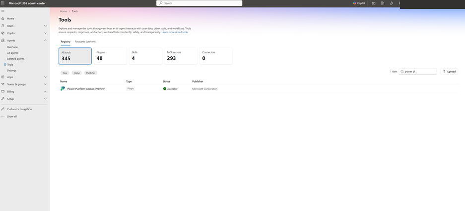  
   Figure: Power Platform Admin (Preview) listed in the Registry tab of the Tools page.

5. Review the plugin overview and select **Install**.

   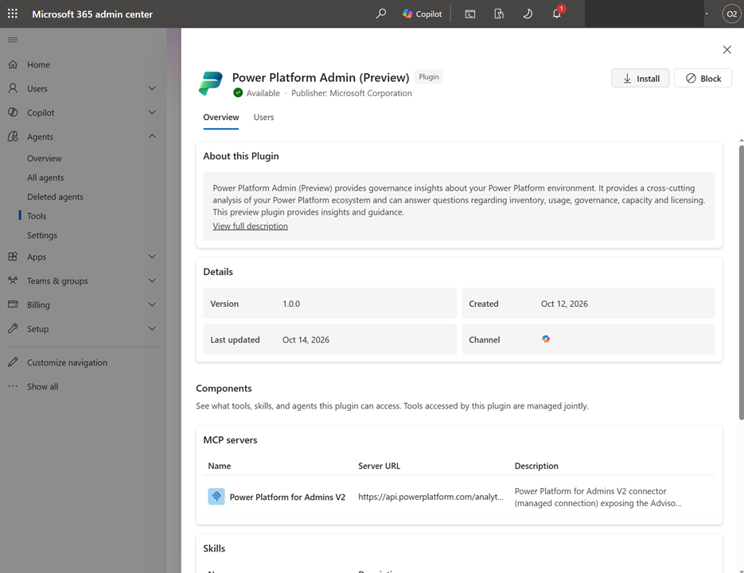  
   Figure: Plugin overview for Power Platform Admin (Preview) with the Install button.

6. On the **Select users** page, confirm that **Channel** is **Copilot**.
7. Under **Installed for**, select **All users** or **Specific users and groups**. If you select specific users and groups, add them when prompted, and include your own account.
8. Select **Next**.

   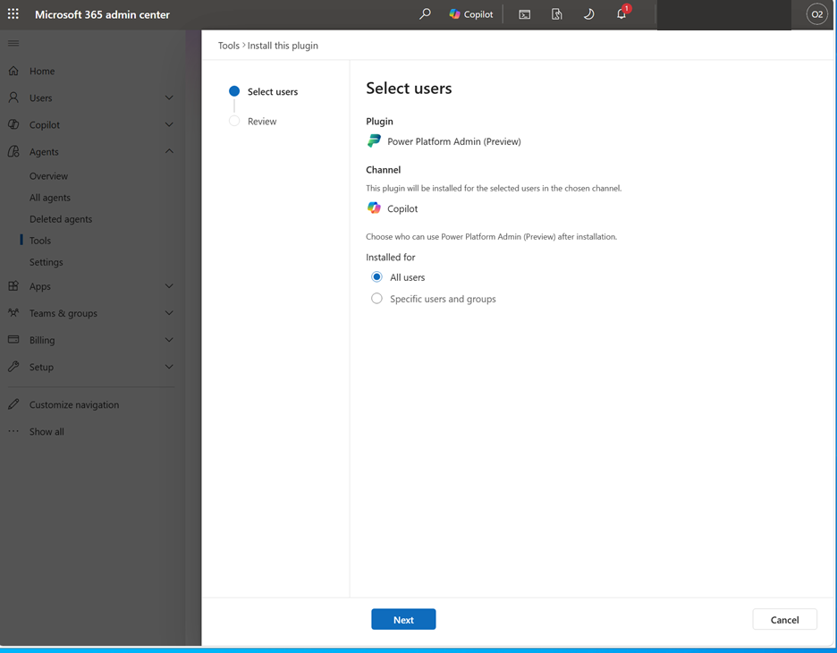  
   Figure: Select users page with the Copilot channel and the Installed for options.

9. On the **Review and install** page, confirm the selected audience and select **Install**.

   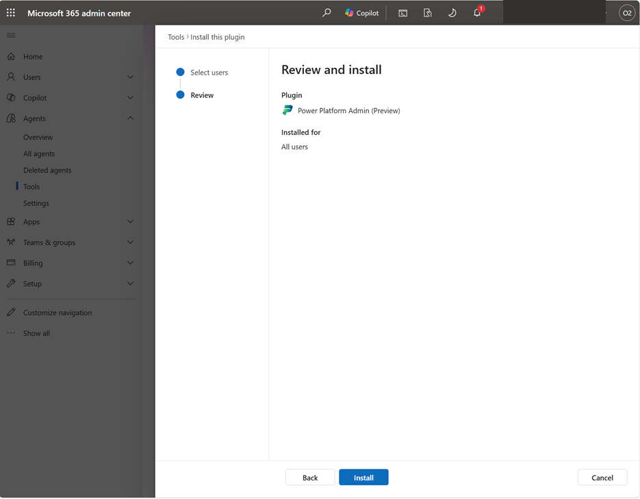  
   Figure: Review and install page showing the plugin set to install for all users.

> 💡 If **Agents** doesn't appear in the navigation pane or you can't install the plugin, your account doesn't have the required Microsoft 365 admin role. Ask your Microsoft 365 administrator to install the plugin for you, with your account in the audience, and then continue with Step 2.

> ✅ The installation completes for the audience you selected. You confirm that the plugin reached your account in the next step.

## Step 2: Connect the plugin in Cowork

1. Open [Microsoft Copilot](https://copilot.cloud.microsoft) with your work or school account and select **Cowork** in the toggle at the top of the page.
2. In Cowork's navigation, select **Customize**.
3. Under **Installed**, find **Power Platform Admin (Preview)** and select **Connect**.

   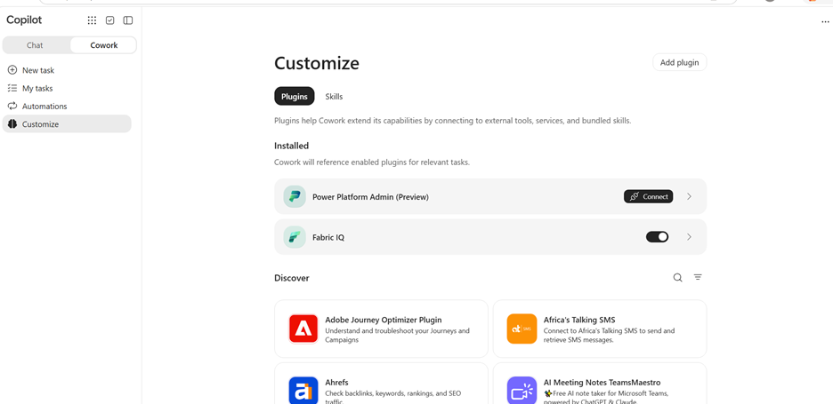  
   Figure: Customize page in Cowork with Power Platform Admin (Preview) under Installed and a Connect button.

4. In the **Connect Power Platform for Admins V2** dialog, set **Authentication Type** to **OAuth Connection**, and then select **Connect**.

   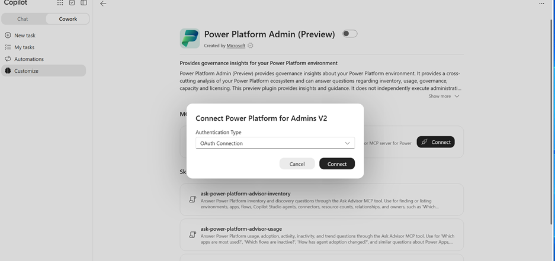  
   Figure: Connect Power Platform for Admins V2 dialog with OAuth Connection selected.

5. Sign in with an account that has one of the required roles. Before you complete consent, confirm that you're using the account and organization you intend to access.
6. Return to Cowork after the connection completes.

> 💡 If **Power Platform Admin (Preview)** doesn't appear under **Installed**, confirm that your account is included in the audience you selected in Step 1. A newly installed plugin can take some time to appear.

> ⚠️ Don't paste passwords, access tokens, or client secrets into a Cowork conversation.

> ✅ The sign-in completes and you're back in Cowork. You confirm that the connection works in the next step.

## Step 3: Ask a first question and approve the request

1. Start a new Cowork conversation, and then enter the following prompt and send it:

   ```
   Which environments do we have, and what types are they?
   ```

2. When Cowork displays an **Ask Advisor** approval card, select **View details** to review the request, and then select **Approve** to continue.

   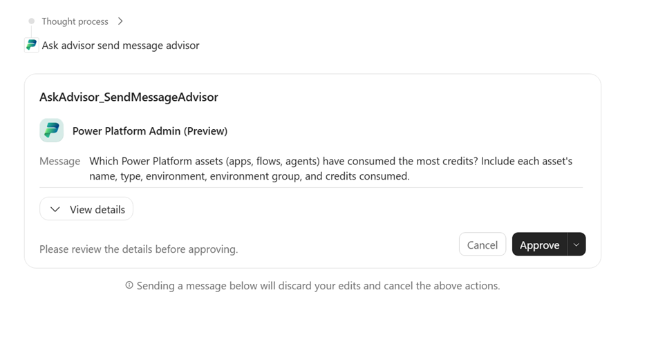  
   Figure: Ask Advisor approval card with the View details and Approve controls.

3. Optionally, to allow future requests without a separate approval prompt, open the menu next to **Approve** and select **Always allow Ask advisor send message advisor**. Choose this option only if you want Cowork to remember this approval.

   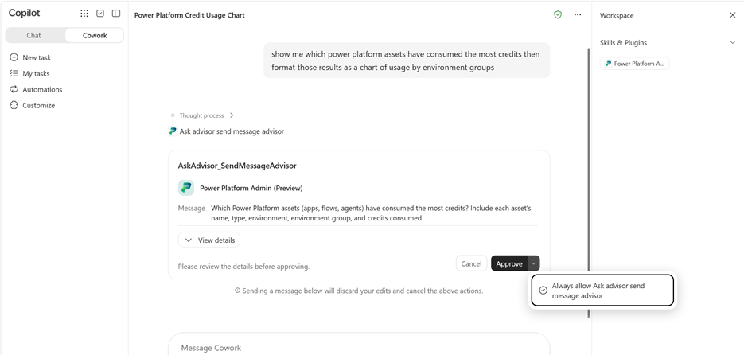  
   Figure: Approval menu with the Always allow Ask advisor send message advisor option.

4. Review the answer. It lists the environments in your tenant and their types — the same environments you filtered on in [Filter inventory](03-filter-inventory.md).

> 💡 If Cowork asks you to connect again, complete the **Power Platform for Admins V2** connection from Step 2 and ask the question again. If Cowork returns no Power Platform data, confirm that the account you connected with has one of the required roles in the intended organization — installing the plugin alone doesn't grant data access.

> ✅ Cowork returns your tenant's environments and their types. The plugin is connected and approved, and you're ready to ask Power Platform questions.

## Step 4: Turn a question into an emailed briefing

This step shows the full journey once: a Power Platform question, the answer, an HTML briefing, and the email in your inbox. The prompts in the next step work the same way.

1. Start a new Cowork conversation, and then enter the following prompt and send it:

   ```
   Use the Power Platform Admin plugin to find what changed in my Power Platform tenant last week, turn it into a one-page HTML briefing, and email it to me.
   ```

   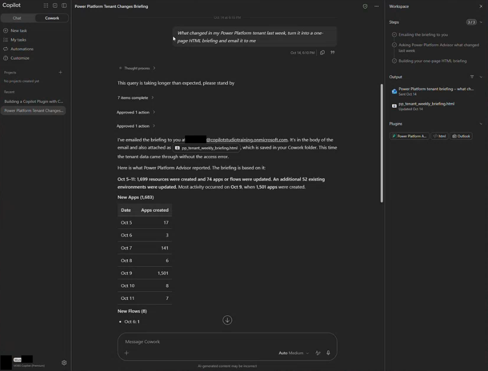  
   Figure: Briefing prompt entered in a new Cowork conversation.

2. Follow along as Cowork plans and runs the steps. It queries the plugin, summarizes the changes, and builds the briefing. If an **Ask Advisor** approval card appears, select **Approve**.
3. When the briefing is ready, it appears in the side panel on the right. Open it and review what was created and changed across apps, flows, and agents, and by whom.

   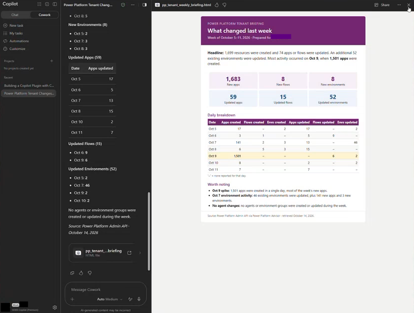  
   Figure: HTML briefing of last week's Power Platform changes in the Cowork side panel.

4. Before it sends the email, Cowork pauses for your approval and shows a preview of the message. Review the preview and select **Send**.
5. Open Outlook and find the briefing email in your inbox.

   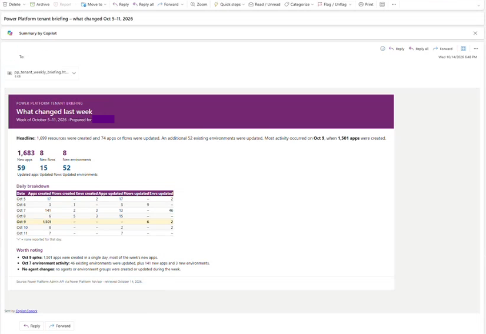  
   Figure: Briefing email from Cowork in the Outlook inbox.

> 💡 You can send this briefing directly because it goes only to you. When you ask Cowork to contact makers or resource owners, ask it to save the emails to your **Drafts** folder so you can review each message before it's sent.

> 💡 If Cowork asks a clarifying question, such as which time zone or format to use, select one of the suggested answers or type your own. If your tenant had little activity last week, the briefing is short — change the prompt to cover the last 30 days instead.

> ⚠️ Answers are AI-generated and can vary between runs and tenants. Validate findings before you contact makers or change policies, environments, or resources.

> ✅ The briefing email is in your Outlook inbox — built from your tenant's data, with no report, flow, or export to maintain.

## Step 5: Try more prompts

Pick the scenarios that matter to your organization and try their prompts in Cowork. You don't need to try them all. Change the time window, environment, connector, or threshold to fit your tenant, and use follow-up questions in the same conversation to refine an answer — the second and third questions often give the most useful results.

### Understand what you have

1. Enter the following prompt:

   ```
   What happened in my Power Platform tenant in the last week?
   ```

2. Follow up in the same conversation:

   ```
   Who created them?
   ```

### Find unused and ownerless resources

1. To build a cleanup list, enter the following prompt:

   ```
   Which apps haven't been used in the last 30 days?
   ```

2. To find resources that are at risk of being orphaned, enter the following prompt:

   ```
   Show me the apps and flows whose owner has left the organization.
   ```

### Manage the default environment

1. To find apps that have outgrown personal productivity, enter the following prompt:

   ```
   Which apps in the default environment are used by more than 10 people? Give me the owner and a link to each.
   ```

### Check the impact before you change a policy

1. To see who's affected before you block a connector, enter the following prompt. It uses the SharePoint connector from [Query with Azure Resource Graph](05-query-resource-graph.md), so you can compare the results — replace it with any connector you're reviewing.

   ```
   If I block the SharePoint connector, which apps, flows, and agents would be affected, and who owns them?
   ```

### Build a showback report

1. Enter the following prompt:

   ```
   Break down app, flow, and agent usage by owner for the last 30 days.
   ```

2. Follow up in the same conversation:

   ```
   Add each owner's department and summarize usage by department as a table.
   ```

### Get a security and governance baseline

1. Enter the following prompt:

   ```
   Give me a security and governance overview of my tenant.
   ```

### Plan environment capacity

1. Enter the following prompt:

   ```
   Show me which environments have limited Dataverse capacity.
   ```

> 💡 Be specific. Include a time window, an environment, a threshold, and the output format you want — for example, "as a table with owner and environment." For more prompts, see the [Governance prompt library for Power Platform Admin in Cowork](https://learn.microsoft.com/en-us/power-platform/guidance/adoption/agentic-governance-prompts), which groups prompts by governance scenario.

> ✅ You've answered at least one more governance question in Cowork without opening the Power Platform admin center.

## Step 6: Reshape and schedule an answer (optional)

1. In the same conversation as one of the answers from Step 5, enter the following prompt and send it:

   ```
   Build an HTML report with this information. Make sure I can filter tables and sort columns by value.
   ```

2. Open the report from the side panel and sort and filter its tables.
3. Optionally, ask for a different format for a different audience, such as a Word report for your governance team or a PowerPoint slide for the steering group.
4. To receive the briefing from Step 4 every week, start a new conversation, and then enter the following prompt and send it:

   ```
   Every Monday at 8 AM, use the Power Platform Admin plugin to find what changed in my Power Platform tenant last week, turn it into a one-page HTML briefing, and email it to me.
   ```

5. In Cowork's navigation, open the **Automations** view and confirm that the schedule appears. You can edit, reschedule, or delete it from there.

> ✅ You have an interactive HTML report you can sort and filter, and — if you completed the last action — a weekly briefing listed in **Automations**.

## Summary and best practices

In this lab you installed the Power Platform Admin plugin, connected it in Cowork, and turned a governance question into a briefing in your inbox. Keep these practices in mind as you use it in your organization:

- **Install for the right audience.** Only accounts with the Global Administrator, Power Platform Administrator, or Dynamics 365 Administrator role get answers, so target your platform team rather than all users.
- **Validate before you act.** Answers are AI-generated and can vary between runs. Check findings before you contact makers or change policies, environments, or resources.
- **Keep a human in the loop.** Approve briefings sent to yourself directly, but ask Cowork to save outreach to makers and resource owners in your **Drafts** folder so you can review each message before it's sent.
- **Pilot before you scale.** Schedule two or three scenarios for a month, use the actual Copilot Credit consumption to set your budget, and configure spending policies in the Microsoft 365 admin center.
- **Reuse what works.** Save prompts that give the right answer, and schedule the ones you need regularly.

> 🥳 Congratulations! You completed the Inventory and Monitoring module. You now have a searchable inventory, repeatable queries, automated reporting, usage insight, a monitoring system that notifies you when something needs attention, and a way to ask your tenant new questions in plain language.

## Additional resources

- [Power Platform Admin in Cowork (Microsoft Learn)](https://learn.microsoft.com/en-us/power-platform/admin/power-platform-admin-cowork) — Prerequisites, installation, connection, approval, and troubleshooting for the plugin.
- [Agentic governance with Power Platform Admin in Cowork (Microsoft Learn)](https://learn.microsoft.com/en-us/power-platform/guidance/adoption/agentic-governance) — How the plugin and Cowork work together, and how to prepare for rollout.
- [Governance prompt library for Power Platform Admin in Cowork (Microsoft Learn)](https://learn.microsoft.com/en-us/power-platform/guidance/adoption/agentic-governance-prompts) — More prompts, grouped by governance scenario.
- [Turn governance answers into reports and automations (Microsoft Learn)](https://learn.microsoft.com/en-us/power-platform/guidance/adoption/agentic-governance-reports) — Reports, scheduled briefings, follow-up actions, and reusable skills.
- [Get started with Copilot Cowork (Microsoft Learn)](https://learn.microsoft.com/en-us/microsoft-365/copilot/cowork/get-started) — How to open Cowork, approve actions, and review results in the side panel.
